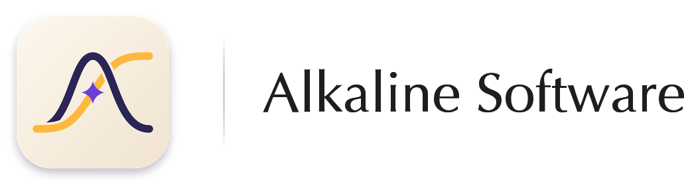
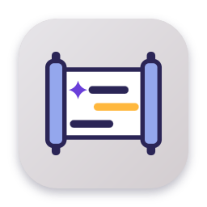
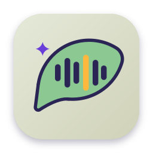
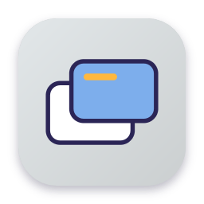
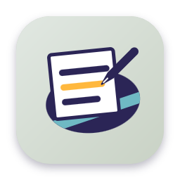

  <picture>
    <source media="(prefers-color-scheme: dark)" srcset="assets/header-dark.png">
    
  </picture>

Alkaline Software is a two-person development team. The name comes from chemistry, where "alkaline" means basic (high pH). We build software that is basic in the sense of "things that should plainly exist."

- **John Paul Helveston, Ph.D.**, Product Lead ([jhelvy.com](https://www.jhelvy.com))
- **Pingfan Hu, Ph.D.**, Principal Engineer & Designer ([pingfan.org](https://pingfan.org))

## Projects

### [Emaki](https://emaki.lol)

The agentic development environment. The agent chat takes the middle of the window, with sessions grouped under their projects. Works with Claude Code and Codex on macOS, Windows and Linux.

 

### [Kotoba](https://github.com/alkaline-software/kotoba)

Dictation anywhere on your Mac, run on your machine so nothing you say leaves it.

 

### [tabflip](https://github.com/alkaline-software/tabflip)

A Mac window switcher: ⌘Tab between windows, not apps.

 

### [Onyx](https://github.com/alkaline-software/onyx)

Markdown notes on your Mac, kept as plain files in a folder of your own.

 

### [MiniCalendar](https://github.com/alkaline-software/MiniCalendar)

A macOS menu bar calendar with Chinese lunar calendar support.

 

Our app development standards live in the [constitution](https://github.com/alkaline-software/constitution).
