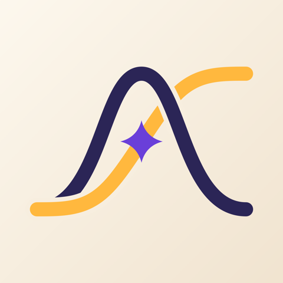
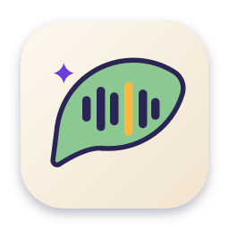

<h1 align="center">Alkaline Software</h1>

Alkaline Software is a two-person development team. The name comes from chemistry, where "alkaline" means basic (high pH). We build software that is basic in the sense of "things that should plainly exist."

- **John Paul Helveston**, engineer and data scientist ([jhelvy.com](https://www.jhelvy.com))
- **Pingfan Hu**, engineer and data scientist ([pingfan.org](https://pingfan.org))

## Projects

### [Emaki](https://emaki.lol)

The agentic development environment. The agent chat takes the middle of the window, with sessions grouped under their projects. Works with Claude Code and Codex on macOS, Windows and Linux.

 

| | |
|:-:|:--|
|  | **[Kotoba](https://github.com/alkaline-software/kotoba)** Dictation anywhere on your Mac, run on your machine so nothing you say leaves it. |
|  | **[tabflip](https://github.com/alkaline-software/tabflip)** A Mac window switcher: ⌘Tab between windows, not apps. |
|  | **[MiniNotes](https://github.com/alkaline-software/MiniNotes)** Quick Markdown notes from the macOS menu bar. |
|  | **[MiniCalendar](https://github.com/alkaline-software/MiniCalendar)** A macOS menu bar calendar with Chinese lunar calendar support. |

Our app development standards live in the [constitution](https://github.com/alkaline-software/constitution).
